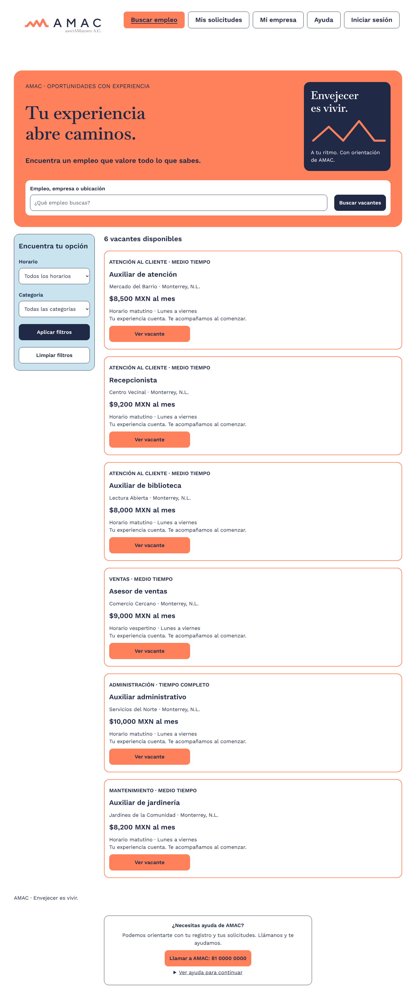
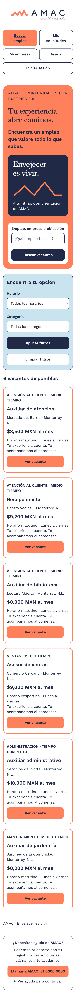

# Bolsa de Trabajo AMAC — Entrega 2 (Maquetación en HTML y CSS)

Maquetación web estática, responsiva y accesible de la plataforma de empleo para personas adultas mayores de **AMAC**, desarrollada a partir de nuestro [prototipo en Figma](https://www.figma.com/design/3BkOcgQYNTJxL8vdlkGdiC/Bolsa-de-Trabajo-AMAC?node-id=0-1).

## Enlaces del proyecto

- **Sitio publicado en Vercel:** [amac-web-entrega2.vercel.app](https://amac-web-entrega2.vercel.app/index.html)
- **Repositorio en GitHub:** [Gael-sanchez-ramos/amac-web-entrega2](https://github.com/Gael-sanchez-ramos/amac-web-entrega2)

## 1. Integrantes del equipo y aportaciones

| Integrante | Qué hizo en esta entrega |
| --- | --- |
| **Gael Sánchez Ramos** | Configuración inicial del repositorio, variables y estructura base de CSS (`css/`), integración de fuentes e imágenes (`fonts/`, `img/`), maquetación del listado de vacantes con buscador y filtros (`index.html`) y páginas de detalle de vacantes (`vacante.html` y `vacante-*.html`). |
| **Rossbel Rodríguez Rubio** | Maquetación de la página de inicio de sesión (`login.html`), formulario accesible de registro de candidato (`registro-candidato.html`) con agrupación semántica (`fieldset`/`legend`), validaciones nativas y pruebas de accesibilidad en Lighthouse. |
| **Ivanna Treviño Pérez** | Maquetación del panel de solicitudes del candidato con los distintos estatus y botón de cancelación (`mis-solicitudes.html`), panel de vacantes y solicitudes recibidas de la empresa (`empresa-vacantes.html`) y capturas responsivas del sitio. |

## 2. Páginas maquetadas y flujo de navegación

El proyecto incluye las 6 páginas obligatorias (más 5 vistas adicionales de detalle para que todas las tarjetas del listado sean navegables):

1. `index.html` — Listado de 6 vacantes con buscador, filtros por horario y categoría, y sección de acompañamiento AMAC.
2. `vacante.html` — Detalle de la vacante con información del puesto, botón **Postularme** y botón **Llamar** directo a la empresa (RF-051).
3. `login.html` — Inicio de sesión para candidatos y enlace a creación de cuenta.
4. `registro-candidato.html` — Formulario de registro dividido en datos personales, dirección, contacto, experiencia laboral y aceptación de términos y privacidad.
5. `mis-solicitudes.html` — Historial con 3 solicitudes en estatus *Pendiente*, *Aceptada* y *Rechazada*. El botón **Cancelar solicitud** solo está activo en la pendiente y deshabilitado con explicación en las ya resueltas (RF-006).
6. `empresa-vacantes.html` — Panel de empresa con el listado de sus vacantes publicadas, controles de gestión y sección de solicitudes recibidas (RF-022).

**Flujo para la demo:** `index.html` (Buscar empleo) → `vacante.html` (Ver vacante) → `login.html` (Postularme / Iniciar sesión) → `mis-solicitudes.html` (Mis solicitudes). En todas las páginas se incluye el encabezado de navegación y el pie de página con el botón visible para llamar a AMAC (RF-052).

## 3. Paleta de colores y tipografías (Variables CSS)

Definidas en `css/variables.css` a partir del diseño en Figma, cuidando un contraste mínimo superior a 4.5:1 para personas adultas mayores:

| Variable CSS | Valor | Uso principal |
| --- | --- | --- |
| `--color-azul` | `#202945` | Texto principal, encabezados editoriales y botones primarios |
| `--color-coral` | `#ff815c` | Bloques destacados (hero), botones de acción y bordes de tarjetas |
| `--color-celeste` | `#cae4ef` | Paneles laterales de filtros, login y bloques de apoyo |
| `--color-fondo` | `#ffffff` | Fondo general de página y texto claro sobre fondo azul |
| `--color-gris` | `#586079` | Texto de placeholders y controles deshabilitados |
| `--color-pendiente` | `#ffdaa6` | Etiqueta de estatus *Pendiente* |
| `--color-aceptada` | `#d9efdf` | Etiqueta de estatus *Aceptada* |
| `--color-rechazada` | `#f8dce0` | Etiqueta de estatus *Rechazada* |
| `--fuente-base` | `"Work Sans", sans-serif` | Cuerpo de texto, etiquetas, botones y formularios (400 y 600) |
| `--fuente-titulo` | `"Baskervville", serif` | Títulos principales (`h1`) y cabeceras destacadas (600) |
| `--texto-base` | `1.125rem` (18px) | Tamaño mínimo de texto en todo el sitio, escalable al 200 % |
| `--alto-control` | `3.5rem` (56px) | Altura mínima de botones y campos para facilitar el clic (> 44px) |

## 4. Componentes reutilizables identificados (para la Entrega 3 en React)

En `css/componentes.css` y `css/layout.css` separamos los estilos por piezas reutilizables pensando en su migración a componentes de React:

- `<Encabezado />` y `<Navegacion />` (`.encabezado`, `.navegacion`): barra superior con logo de AMAC, enlaces principales e indicador de página activa (`aria-current="page"`).
- `<Pie />` y `<AyudaAmac />` (`.pie`, `.ayuda`): pie de página común con el bloque de orientación desplegable (`
`) y botón de llamada directa a AMAC.
- `<Boton />` (`.boton`, `.boton--coral`, `.boton--azul`, `.boton--ancho`): botones y enlaces de acción con tamaño táctil amplio y estados `:hover`, `:focus-visible` y `:disabled`.
- `<TarjetaVacante />` (`.tarjeta-vacante`): tarjeta reutilizada en las 6 ofertas de `index.html` con categoría, título, empresa, sueldo, horario y enlace al detalle.
- `<TarjetaSolicitud />` (`.tarjeta-solicitud`): tarjeta de seguimiento de postulaciones del candidato en `mis-solicitudes.html`.
- `<TarjetaEmpresa />` (`.tarjeta-empresa`): tarjeta de administración de vacantes publicadas en `empresa-vacantes.html`.
- `<EtiquetaEstatus />` (`.etiqueta-estatus` y modificadores `--pendiente`, `--aceptada`, `--rechazada`, `--aprobada`): insignia visual para el estado de solicitudes y empresas.
- `<CampoFormulario />` (`.campo-formulario`): contenedor de `<label>` visible + `<input>` / `<select>` / `<textarea>` reutilizado en el buscador, filtros, login y registro.
- `<CabeceraEditorial />` (`.cabecera-editorial`): bloque superior de título y contexto en páginas interiores.

## 5. Ajustes respecto al prototipo de Figma

- En `index.html` ampliamos el listado de 3 a 6 vacantes y en `mis-solicitudes.html` mostramos 3 solicitudes con estados distintos (*Pendiente*, *Aceptada* y *Rechazada*) para cumplir con todos los requisitos del entregable.
- Reemplazamos los anchos fijos del lienzo de Figma por contenedores fluidos (`min-width` con Grid y Flexbox *mobile-first*) para evitar cualquier scroll horizontal desde 320px hasta 1440px y al hacer zoom al 200 %.
- Añadimos mejoras de accesibilidad sobre el diseño original: enlace *"Saltar al contenido"* al presionar `Tab`, contorno de foco visible (`.saltar-contenido` y `:focus-visible`) y etiquetas `<label>` explícitas en todos los controles.

## 6. Capturas de pantalla y validación de accesibilidad

### Vista en escritorio (`index.html` — 1440px)

### Vista en celular (`index.html` — 375px)

### Puntaje de Lighthouse – Accessibility (`index.html`)

